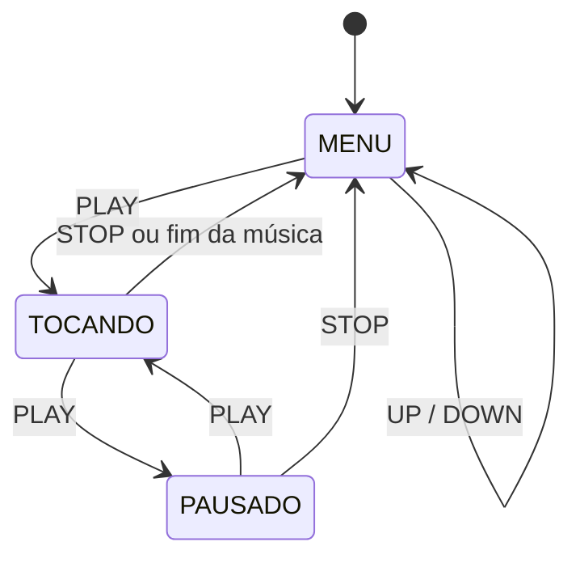

<!--
RASCUNHO: revise todo o texto e complete os trechos marcados com [PREENCHER]
(nomes, fotos, videos, resultados reais dos seus testes).
Apague este comentario antes da entrega.
-->

# Reprodutor de Músicas com Arduino UNO

**CCP020 – Digital Experience Ultimate** · Centro Universitário FEI · Prof. Isaac

**Integrantes:** [PREENCHER nome 1] · [PREENCHER nome 2]

---

## 1. Introdução

### 1.1 Problema

Aparelhos como os antigos MP3 players permitem escolher uma música em uma lista, tocá-la, pausá-la e voltar ao menu. O desafio deste projeto é reproduzir esse comportamento em um sistema embarcado simples, usando um Arduino UNO, que tem apenas **2 KB de RAM** e nenhum cartão de memória: as músicas precisam caber na própria memória do microcontrolador.

### 1.2 Objetivos

- Armazenar **no mínimo 5 músicas** na memória do Arduino.
- Listar os nomes das músicas em um **display LCD 16x2** e permitir a seleção com os botões **UP** e **DOWN**.
- Tocar a música escolhida em um **buzzer** ao pressionar **PLAY**.
- Permitir **pausar/retomar** (botão PLAY/PAUSE) e **interromper** a música voltando ao menu (botão STOP).
- Indicar o estado com LEDs: **verde** enquanto toca e **vermelho** quando pausada.

---

## 2. Metodologia

### 2.1 Materiais utilizados

| Qtd. | Componente | Função no projeto |
|:---:|---|---|
| 1 | Arduino UNO R3 | Microcontrolador que executa o programa |
| 1 | Display LCD 16x2 com interface I2C | Mostra o menu e o estado da reprodução |
| 4 | Botões (push button) | UP, DOWN, PLAY/PAUSE e STOP |
| 1 | LED verde | Indica "tocando" |
| 1 | LED vermelho | Indica "pausado" |
| 2 | Resistores de 220 Ω | Limitam a corrente dos LEDs |
| 1 | Buzzer piezo | Reproduz as notas |
| 1 | Protoboard | Montagem dos componentes |
| — | Fios (jumpers) | Conexões |

> O projeto foi montado e simulado no **Tinkercad Circuits**.

### 2.2 Métodos

#### Esquema de ligação

| Componente | Pino do Arduino |
|---|:---:|
| Botão UP | D5 |
| Botão DOWN | D4 |
| Botão PLAY/PAUSE | D3 |
| Botão STOP | D2 |
| LED verde (via 220 Ω) | D9 |
| LED vermelho (via 220 Ω) | D8 |
| Buzzer (+) | D10 |
| LCD I2C – SDA | A4 |
| LCD I2C – SCL | A5 |
| LCD I2C – VCC / GND | 5V / GND |

- Cada botão tem um terminal no pino do Arduino e o outro no **GND**. Os pinos são configurados com `INPUT_PULLUP`, então o botão pressionado é lido como `LOW` e **não é necessário resistor externo**.
- Os LEDs têm o cátodo ligado ao GND e o ânodo ligado ao pino por meio do resistor de 220 Ω.
- O buzzer tem o terminal negativo no GND.

**Foto do projeto montado:**


<!-- [PREENCHER] Coloque aqui o print do seu circuito no Tinkercad -->

#### Desenvolvimento do software

O código está em [`reprodutor_musicas.ino`](reprodutor_musicas.ino) e foi escrito em C++ para Arduino, usando as bibliotecas `Adafruit_LiquidCrystal` (LCD I2C do Tinkercad, com o expansor MCP23008 no endereço padrão 0x20) e `avr/pgmspace.h`.

**a) Armazenamento das músicas na memória FLASH**

Cada música é um vetor de notas, e cada nota é uma estrutura com a **frequência** (Hz) e a **duração** (ms). Os vetores usam `PROGMEM`, o que os mantém na memória FLASH (32 KB) em vez da RAM (2 KB). Os dados são lidos durante a execução com `memcpy_P`. Os nomes das músicas também ficam na FLASH.

```cpp
struct Nota {
  uint16_t frequencia;
  uint16_t duracao;   // tempo total da nota, em milissegundos
};

const Nota Musica2[] PROGMEM = { {SOL4,900}, {LA4,300}, ... };
```

**b) Máquina de estados**

O programa funciona como uma máquina de estados com três estados:



| Estado | LED verde | LED vermelho | LCD |
|---|:---:|:---:|---|
| `MENU` | apagado | apagado | Lista de músicas com `>` na selecionada |
| `TOCANDO` | **aceso** | apagado | "Tocando" + nome da música |
| `PAUSADO` | apagado | **aceso** | "Pausado" + nome da música |

**c) Reprodução sem bloquear o programa**

Em vez de `delay()`, a reprodução usa `millis()`. A cada volta do `loop()` o programa verifica se a nota atual já terminou e, se sim, carrega a próxima. Assim os botões continuam respondendo durante a música. O som é gerado com `tone()` e interrompido com `noTone()`; os últimos 10% de cada nota ficam em silêncio para separar notas repetidas.

**d) Pausa e retomada**

Ao pausar, o programa guarda o instante da pausa. Ao retomar, soma o tempo parado a `inicioNota`, de modo que a nota continua de onde parou e a música segue da nota em que estava.

**e) Debounce dos botões**

Cada botão tem um debounce por software: a leitura só é aceita depois de ficar estável por 30 ms, e o evento é gerado apenas na borda de descida (um clique = uma ação).

#### Músicas

| # | Música | Observação |
|:---:|---|---|
| 1 | [PREENCHER – ex.: Hino do Corinthians] | [PREENCHER – fonte das notas] |
| 2 | Noite Feliz | Melodia de domínio público, andamento lento |
| 3 | Para Elise (Beethoven) | Tema principal, versão monofônica |
| 4 | [PREENCHER] | [PREENCHER] |
| 5 | [PREENCHER] | [PREENCHER] |

> O buzzer toca uma nota por vez, então todas as músicas são arranjos simplificados da melodia principal.

---

## 3. Experimentos

Mostre a sequência de funcionamento com fotos e uma breve explicação de cada etapa.

### 3.1 Menu inicial


[PREENCHER: explique o que aparece no LCD e como UP/DOWN movem o cursor.]

### 3.2 Navegando pela lista


[PREENCHER]

### 3.3 Música tocando


[PREENCHER: LCD mostrando "Tocando", LED verde aceso e buzzer ativo.]

### 3.4 Música pausada


[PREENCHER: LCD mostrando "Pausado" e LED vermelho aceso.]

### 3.5 Retorno ao menu (STOP)


[PREENCHER]

### 3.6 Vídeo de demonstração

[PREENCHER: link do vídeo mostrando todas as funções, incluindo o som do buzzer.]

### 3.7 Dificuldades encontradas

<!-- [PREENCHER com o que realmente aconteceu no seu desenvolvimento. Exemplos: -->
<!--  - buzzer sem som por causa de pino diferente entre o código e o circuito; -->
<!--  - endereço/biblioteca do LCD I2C no Tinkercad; -->
<!--  - ajuste do tempo das notas. -->

---

## 4. Tecnologias utilizadas

- **Arduino UNO** (ATmega328P)
- **C++ para Arduino** (Arduino IDE / editor de código do Tinkercad)
- **Tinkercad Circuits** – montagem e simulação
- Bibliotecas: `Adafruit_LiquidCrystal`, `avr/pgmspace.h`
- **Git e GitHub** – versionamento do código e deste relatório

---

## 5. Conclusão

[PREENCHER com suas palavras: descreva de forma detalhada como o problema foi resolvido.]

Pontos que a conclusão deve cobrir:

1. **Como as músicas foram guardadas** e por que `PROGMEM` foi necessário (limite de 2 KB de RAM).
2. **Como o menu e os estados** (`MENU`, `TOCANDO`, `PAUSADO`) foram organizados.
3. **Como a música toca sem travar os botões** (uso de `millis()` no lugar de `delay()`).
4. **Como pausa e retomada preservam a posição** na música.
5. **Como os requisitos do enunciado foram atendidos**: 5 músicas, 4 botões, LEDs de estado, buzzer e LCD 16x2.
6. **Resultados dos testes** e possíveis melhorias (mais músicas, repetição automática, controle de volume, tempo da música no LCD).

---

## 6. Como executar

1. Abra o circuito no Tinkercad (ou monte os componentes conforme a tabela de pinos).
2. Abra **Código → Texto**, apague o conteúdo e cole o conteúdo de `reprodutor_musicas.ino`.
3. Clique em **Iniciar simulação**.
4. Use **UP/DOWN** para escolher a música e **PLAY** para iniciar.

## 7. Estrutura do repositório

```
.
├── README.md
├── reprodutor_musicas.ino
└── imagens/
    ├── circuito-montado.png
    └── ... (fotos dos experimentos)
```

## 8. Referências

- Documentação oficial do Arduino: https://docs.arduino.cc
- Tinkercad Circuits: https://www.tinkercad.com
- Material da disciplina CCP020 (slides do Prof. Isaac)
- [PREENCHER: fonte das notas do hino e das demais músicas]
