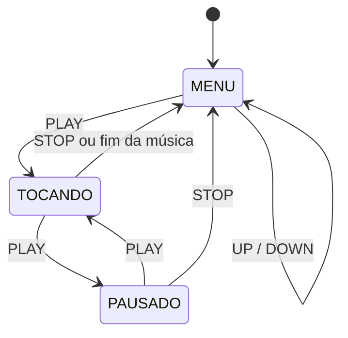

# Reprodutor de Músicas com Arduino UNO

**CCP020 – Digital Experience Ultimate** · Centro Universitário FEI ·

**Integrantes:** Felipe Nunes Recupero RA:22.126.033-4

---

## 1. Introdução

### 1.1 Problema

Aparelhos como os antigos MP3 players permitem escolher uma música em uma lista, tocá-la, pausá-la e voltar ao menu. O desafio deste projeto é reproduzir esse comportamento em um sistema embarcado simples, usando um Arduino UNO, que tem apenas **2 KB de RAM** e nenhum cartão de memória: as músicas precisam caber na própria memória do microcontrolador.

### 1.2 Objetivos

- Armazenar **no mínimo 5 músicas** na memória do Arduino.
- Listar os nomes das músicas em um **display LCD 16x2** e permitir a seleção com os botões **UP** e **DOWN**.
- Tocar a música escolhida em um **buzzer** ao pressionar **PLAY**.
- Permitir **pausar/retomar** (botão PLAY/PAUSE) e **interromper** a música voltando ao menu (botão STOP).
- Indicar o estado com LEDs: **verde** enquanto toca e **vermelho** quando pausada.

---

## 2. Metodologia

### 2.1 Materiais utilizados

| Qtd. | Componente | Função no projeto |
|:---:|---|---|
| 1 | Arduino UNO R3 | Microcontrolador que executa o programa |
| 1 | Display LCD 16x2 com módulo I2C | Mostra o menu e o estado da reprodução |
| 4 | Botões (push button) | UP, DOWN, PLAY/PAUSE e STOP |
| 1 | LED verde | Indica "tocando" |
| 1 | LED vermelho | Indica "pausado" |
| 2 | Resistores de 220 Ω (faixa de 220 a 330 Ω) | Limitam a corrente dos LEDs |
| 1 | Buzzer **passivo** | Reproduz as notas |
| 1 | Protoboard | Montagem dos componentes |
| — | Fios (jumpers) | Conexões |

> O buzzer precisa ser **passivo**: o buzzer ativo emite um único tom fixo e não toca melodias.

### 2.2 Métodos

#### Esquema de ligação

| Componente | Pino do Arduino |
|---|:---:|
| Botão UP | D5 |
| Botão DOWN | D4 |
| Botão PLAY/PAUSE | D3 |
| Botão STOP | D2 |
| LED verde (via resistor) | D9 |
| LED vermelho (via resistor) | D8 |
| Buzzer (+) | D10 |
| LCD I2C – SDA | A4 |
| LCD I2C – SCL | A5 |
| LCD I2C – VCC / GND | 5V / GND |

- Cada botão tem um terminal no pino do Arduino e o outro no **GND**. Os pinos usam `INPUT_PULLUP`, então o botão pressionado é lido como `LOW` e **não é necessário resistor externo**.
- Os LEDs têm o cátodo ligado ao GND e o ânodo ligado ao pino por meio do resistor.
- O buzzer tem o terminal negativo no GND.
- Todos os GNDs (LCD, LEDs, botões e buzzer) estão ligados ao GND do Arduino.


#### Desenvolvimento do software

O código está em [`reprodutor_ccp020.ino`](reprodutor_ccp020/reprodutor_ccp020.ino), escrito em C++ para Arduino e carregado pela **Arduino IDE**. Ele usa a biblioteca `LiquidCrystal_I2C` para o display (endereço I2C `0x27`; alguns módulos usam `0x3F`) e `avr/pgmspace.h` para guardar os dados na memória FLASH.

**a) Armazenamento das músicas na memória FLASH**

Cada música é um vetor de notas, e cada nota é uma estrutura com a **frequência** (Hz) e a **duração** (ms). A frequência `0` representa um silêncio. Os vetores usam `PROGMEM`, o que os mantém na memória FLASH (32 KB) em vez da RAM (2 KB). Os dados são lidos durante a execução com `memcpy_P`. Os nomes das músicas também ficam na FLASH.

```cpp
struct Nota {
  uint16_t frequencia;
  uint16_t duracao;   // tempo total da nota, em milissegundos
};

const Nota brilha[] PROGMEM = { {262,600},{330,600},{294,600}, ... };
```

**b) Máquina de estados**

O programa funciona como uma máquina de estados com três estados:



| Estado | LED verde | LED vermelho | LCD |
|---|:---:|:---:|---|
| `MENU` | apagado | apagado | Duas músicas da lista, com `>` na selecionada |
| `TOCANDO` | **aceso** | apagado | "Tocando" + nome da música |
| `PAUSADO` | apagado | **aceso** | "Pausado" + nome da música |

O menu é circular: ao passar da última música com DOWN volta para a primeira, e o contrário com UP. O botão STOP tem prioridade sobre os demais.

**c) Reprodução sem bloquear o programa**

Em vez de `delay()`, a reprodução usa `millis()`. A cada volta do `loop()` o programa verifica se a nota atual já terminou e, se sim, carrega a próxima, então os botões continuam respondendo durante a música. O som é gerado com `tone()` e interrompido com `noTone()`. Entre duas notas há um silêncio fixo de 8 ms (`INTERVALO_NOTAS_MS`), que separa notas repetidas sem cortar o som das notas longas. Para manter o ritmo constante, o início da nota seguinte é calculado somando a duração da nota anterior (`inicioNota += duracao`), sem acumular o atraso das voltas do `loop()`.

**d) Pausa e retomada**

Ao pausar, o programa guarda o instante da pausa e silencia o buzzer. Ao retomar, soma o tempo parado a `inicioNota`, de modo que a nota continua de onde parou e a música segue da nota em que estava.

**e) Debounce dos botões**

Cada botão tem um debounce por software: a leitura só é aceita depois de ficar estável por 30 ms, e o evento é gerado apenas quando o botão é pressionado (um clique = uma ação).

#### Músicas

As cinco melodias são arranjos monofônicos (uma nota por vez, limitação do buzzer) com ritmos e contornos diferentes:

| # | Nome no menu | Características |
|:---:|---|---|
| 1 | Musica1 | Arpejos em Dó maior, andamento moderado |
| 2 | Musica2 | Registro mais grave (262 a 392 Hz), notas longas e pausas |
| 3 | Musica3 | Motivo agudo e mais rápido, com síncopas |
| 4 | Musica4 | Ritmo ternário, notas mais longas no início da frase |
| 5 | Musica5 | Sequência pentatônica com saltos e resposta descendente |


---

## 3. Experimentos

 Link do video do arduino em funcionamento: https://youtu.be/nFF1KvU59IY
 Foto: https://drive.google.com/file/d/1yw5Jk2PUYbHG06rXX5LHBxhr-mleeKdW/view?usp=sharing


---

## 4. Tecnologias utilizadas

- **Arduino UNO** (ATmega328P)
- **C++ para Arduino**, com a **Arduino IDE**
- Bibliotecas: `LiquidCrystal_I2C`, `Wire`, `avr/pgmspace.h`
- **Git e GitHub** – versionamento do código e deste relatório

---

## 5. Conclusão

O objetivo do projeto, construir um reprodutor de músicas funcional em um Arduino UNO, com músicas gravadas na memória, menu no LCD e controle por botões, foi atingido. O funcionamento completo pode ser visto no vídeo da seção 3.

**Armazenamento das músicas.** O principal desafio técnico foi o limite de 2 KB de RAM do Arduino UNO. Para resolvê-lo, cada música foi representada como um vetor de estruturas `Nota` (frequência em Hz e duração em ms) declarado com `PROGMEM`, o que mantém os dados na memória FLASH de 32 KB. Durante a execução, apenas a nota atual é copiada para a RAM com `memcpy_P`, e os nomes das músicas também ficam na FLASH. Assim, as cinco músicas não consomem RAM, e novas músicas podem ser adicionadas apenas criando um novo vetor e uma nova entrada na tabela `biblioteca`.

**Organização do programa.** O comportamento foi organizado em uma máquina de estados com três estados: `MENU`, `TOCANDO` e `PAUSADO`. No menu, UP e DOWN percorrem a lista de forma circular e PLAY inicia a música selecionada. Durante a música, PLAY alterna entre tocar e pausar, e STOP volta ao menu em qualquer momento, com prioridade sobre os demais botões. A cada mudança de estado, o LCD e os LEDs são atualizados: LED verde aceso enquanto toca, LED vermelho aceso quando pausada, e ambos apagados no menu.

**Reprodução sem travar o programa.** Em vez de `delay()`, a reprodução usa `millis()`. A cada volta do `loop()` o programa verifica se a nota atual terminou e, se sim, carrega a próxima. Como os botões são lidos continuamente, é possível pausar ou parar a música a qualquer instante. O som é gerado com `tone()` e interrompido com `noTone()`, com um silêncio fixo de 8 ms entre as notas para separar notas repetidas. O ritmo se mantém constante porque o início da próxima nota é calculado somando a duração da nota anterior (`inicioNota += duracao`), sem acumular o atraso das voltas do `loop()`.

**Pausa e retomada.** Ao pausar, o programa guarda o instante da pausa e silencia o buzzer. Ao retomar, o tempo parado é descontado de `inicioNota`, então a música continua na mesma nota em que parou, sem reiniciar.

**Leitura dos botões.** Os botões usam `INPUT_PULLUP`, o que dispensa resistores externos. Um debounce por software, que exige 30 ms de leitura estável, junto com a detecção do momento em que o botão é pressionado, garante que cada clique gere uma única ação.

**Atendimento aos requisitos.** Todos os itens do enunciado foram atendidos:

- 5 músicas armazenadas na memória do Arduino;
- lista com os nomes das músicas no LCD 16x2, com seleção por UP e DOWN;
- reprodução da música escolhida no buzzer ao pressionar PLAY;
- botões de PLAY/PAUSE e STOP, totalizando os 4 botões pedidos;
- LED verde enquanto toca e LED vermelho quando pausada.

**Dificuldades encontradas.** A primeira foi a diferença entre o simulador e o hardware real. O LCD I2C do Tinkercad usa um expansor MCP23008 com a biblioteca `Adafruit_LiquidCrystal` (endereço `0x20`), enquanto o módulo físico usa o PCF8574 com a biblioteca `LiquidCrystal_I2C` (endereço `0x27`, ou `0x3F` em alguns módulos), o que exigiu adaptar o código de inicialização do display. A segunda foi garantir que os pinos usados no código correspondessem exatamente às ligações do circuito: um pino trocado entre o buzzer e um LED impedia que as notas fossem tocadas. Por fim, foi necessário usar um buzzer **passivo**, pois o ativo emite apenas um tom fixo.

**Melhorias futuras.** O projeto pode evoluir com mais músicas ou músicas gravadas em um cartão SD, repetição automática e modo aleatório, botões para avançar e voltar de música durante a reprodução, controle de volume e exibição do tempo ou do progresso da música no LCD.

---

## 6. Como executar

1. Monte o circuito conforme a tabela de pinos.
2. Na Arduino IDE, instale a biblioteca **LiquidCrystal I2C** (Sketch → Incluir Biblioteca → Gerenciar Bibliotecas).
3. Abra `reprodutor_ccp020/reprodutor_ccp020.ino`, selecione a placa **Arduino Uno** e a porta, e carregue o programa.
4. Use **UP/DOWN** para escolher a música e **PLAY** para iniciar.


