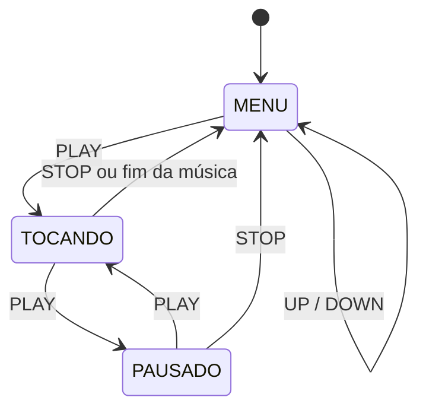

# Reprodutor de Músicas com Arduino UNO

**CCP020 – Digital Experience Ultimate** · Centro Universitário FEI · Prof. Isaac

**Integrantes:** Felipe Nunes Recupero RA:22.126.033-4

---

## 1. Introdução

### 1.1 Problema

Aparelhos como os antigos MP3 players permitem escolher uma música em uma lista, tocá-la, pausá-la e voltar ao menu. O desafio deste projeto é reproduzir esse comportamento em um sistema embarcado simples, usando um Arduino UNO, que tem apenas **2 KB de RAM** e nenhum cartão de memória: as músicas precisam caber na própria memória do microcontrolador.

### 1.2 Objetivos

- Armazenar **no mínimo 5 músicas** na memória do Arduino.
- Listar os nomes das músicas em um **display LCD 16x2** e permitir a seleção com os botões **UP** e **DOWN**.
- Tocar a música escolhida em um **buzzer** ao pressionar **PLAY**.
- Permitir **pausar/retomar** (botão PLAY/PAUSE) e **interromper** a música voltando ao menu (botão STOP).
- Indicar o estado com LEDs: **verde** enquanto toca e **vermelho** quando pausada.

---

## 2. Metodologia

### 2.1 Materiais utilizados

| Qtd. | Componente | Função no projeto |
|:---:|---|---|
| 1 | Arduino UNO R3 | Microcontrolador que executa o programa |
| 1 | Display LCD 16x2 com módulo I2C | Mostra o menu e o estado da reprodução |
| 4 | Botões (push button) | UP, DOWN, PLAY/PAUSE e STOP |
| 1 | LED verde | Indica "tocando" |
| 1 | LED vermelho | Indica "pausado" |
| 2 | Resistores de 220 Ω (faixa de 220 a 330 Ω) | Limitam a corrente dos LEDs |
| 1 | Buzzer **passivo** | Reproduz as notas |
| 1 | Protoboard | Montagem dos componentes |
| — | Fios (jumpers) | Conexões |

> O buzzer precisa ser **passivo**: o buzzer ativo emite um único tom fixo e não toca melodias.

### 2.2 Métodos

#### Esquema de ligação

| Componente | Pino do Arduino |
|---|:---:|
| Botão UP | D5 |
| Botão DOWN | D4 |
| Botão PLAY/PAUSE | D3 |
| Botão STOP | D2 |
| LED verde (via resistor) | D9 |
| LED vermelho (via resistor) | D8 |
| Buzzer (+) | D10 |
| LCD I2C – SDA | A4 |
| LCD I2C – SCL | A5 |
| LCD I2C – VCC / GND | 5V / GND |

- Cada botão tem um terminal no pino do Arduino e o outro no **GND**. Os pinos usam `INPUT_PULLUP`, então o botão pressionado é lido como `LOW` e **não é necessário resistor externo**.
- Os LEDs têm o cátodo ligado ao GND e o ânodo ligado ao pino por meio do resistor.
- O buzzer tem o terminal negativo no GND.
- Todos os GNDs (LCD, LEDs, botões e buzzer) estão ligados ao GND do Arduino.

**Foto do projeto montado:**


<!-- [PREENCHER] Foto do seu circuito montado -->


#### Desenvolvimento do software

O código está em [`reprodutor_ccp020.ino`](reprodutor_ccp020/reprodutor_ccp020.ino), escrito em C++ para Arduino e carregado pela **Arduino IDE**. Ele usa a biblioteca `LiquidCrystal_I2C` para o display (endereço I2C `0x27`; alguns módulos usam `0x3F`) e `avr/pgmspace.h` para guardar os dados na memória FLASH.

**a) Armazenamento das músicas na memória FLASH**

Cada música é um vetor de notas, e cada nota é uma estrutura com a **frequência** (Hz) e a **duração** (ms). A frequência `0` representa um silêncio. Os vetores usam `PROGMEM`, o que os mantém na memória FLASH (32 KB) em vez da RAM (2 KB). Os dados são lidos durante a execução com `memcpy_P`. Os nomes das músicas também ficam na FLASH.

```cpp
struct Nota {
  uint16_t frequencia;
  uint16_t duracao;   // tempo total da nota, em milissegundos
};

const Nota brilha[] PROGMEM = { {262,600},{330,600},{294,600}, ... };
```

**b) Máquina de estados**

O programa funciona como uma máquina de estados com três estados:



| Estado | LED verde | LED vermelho | LCD |
|---|:---:|:---:|---|
| `MENU` | apagado | apagado | Duas músicas da lista, com `>` na selecionada |
| `TOCANDO` | **aceso** | apagado | "Tocando" + nome da música |
| `PAUSADO` | apagado | **aceso** | "Pausado" + nome da música |

O menu é circular: ao passar da última música com DOWN volta para a primeira, e o contrário com UP. O botão STOP tem prioridade sobre os demais.

**c) Reprodução sem bloquear o programa**

Em vez de `delay()`, a reprodução usa `millis()`. A cada volta do `loop()` o programa verifica se a nota atual já terminou e, se sim, carrega a próxima, então os botões continuam respondendo durante a música. O som é gerado com `tone()` e interrompido com `noTone()`. Entre duas notas há um silêncio fixo de 8 ms (`INTERVALO_NOTAS_MS`), que separa notas repetidas sem cortar o som das notas longas. Para manter o ritmo constante, o início da nota seguinte é calculado somando a duração da nota anterior (`inicioNota += duracao`), sem acumular o atraso das voltas do `loop()`.

**d) Pausa e retomada**

Ao pausar, o programa guarda o instante da pausa e silencia o buzzer. Ao retomar, soma o tempo parado a `inicioNota`, de modo que a nota continua de onde parou e a música segue da nota em que estava.

**e) Debounce dos botões**

Cada botão tem um debounce por software: a leitura só é aceita depois de ficar estável por 30 ms, e o evento é gerado apenas quando o botão é pressionado (um clique = uma ação).

#### Músicas

As cinco melodias são arranjos monofônicos (uma nota por vez, limitação do buzzer) com ritmos e contornos diferentes:

| # | Nome no menu | Características |
|:---:|---|---|
| 1 | Musica1 | Arpejos em Dó maior, andamento moderado |
| 2 | Musica2 | Registro mais grave (262 a 392 Hz), notas longas e pausas |
| 3 | Musica3 | Motivo agudo e mais rápido, com síncopas |
| 4 | Musica4 | Ritmo ternário, notas mais longas no início da frase |
| 5 | Musica5 | Sequência pentatônica com saltos e resposta descendente |

<!-- [PREENCHER] Se trocar os nomes no menu (ate 15 letras) ou se as melodias forem baseadas em musicas conhecidas, informe aqui o nome e a fonte das notas. -->

---

## 3. Experimentos

Mostre a sequência de funcionamento com fotos e uma breve explicação de cada etapa.

### 3.1 Menu inicial


[PREENCHER: explique o que aparece no LCD e como UP/DOWN movem o cursor.]

### 3.2 Navegando pela lista


[PREENCHER]

### 3.3 Música tocando


[PREENCHER: LCD mostrando "Tocando", LED verde aceso e buzzer ativo.]

### 3.4 Música pausada


[PREENCHER: LCD mostrando "Pausado" e LED vermelho aceso.]

### 3.5 Retorno ao menu (STOP)


[PREENCHER]

### 3.6 Vídeo de demonstração

[PREENCHER: link do vídeo mostrando todas as funções, incluindo o som do buzzer.]

### 3.7 Dificuldades encontradas

<!-- [PREENCHER com o que realmente aconteceu no seu desenvolvimento. Exemplos: -->
<!--  - LCD sem imagem: endereço I2C (0x27 ou 0x3F) e ajuste de contraste; -->
<!--  - diferença entre a biblioteca do LCD no Tinkercad e na Arduino IDE; -->
<!--  - buzzer sem som por ser ativo, ou pino diferente entre código e circuito; -->
<!--  - botões ligados em pernas erradas. -->

---

## 4. Tecnologias utilizadas

- **Arduino UNO** (ATmega328P)
- **C++ para Arduino**, com a **Arduino IDE**
- Bibliotecas: `LiquidCrystal_I2C`, `Wire`, `avr/pgmspace.h`
- **Tinkercad Circuits** – simulação do circuito [PREENCHER: apague se não usou]
- **Git e GitHub** – versionamento do código e deste relatório

---

## 5. Conclusão

[PREENCHER com suas palavras: descreva de forma detalhada como o problema foi resolvido.]

Pontos que a conclusão deve cobrir:

1. **Como as músicas foram guardadas** e por que `PROGMEM` foi necessário (limite de 2 KB de RAM).
2. **Como o menu e os estados** (`MENU`, `TOCANDO`, `PAUSADO`) foram organizados.
3. **Como a música toca sem travar os botões** (uso de `millis()` no lugar de `delay()`) e como o ritmo foi mantido constante.
4. **Como pausa e retomada preservam a posição** na música.
5. **Como os requisitos do enunciado foram atendidos**: 5 músicas, 4 botões, LEDs de estado, buzzer e LCD 16x2.
6. **Resultados dos testes** (use o uso de memória que a Arduino IDE informa ao compilar: [PREENCHER]) e possíveis melhorias (mais músicas, repetição automática, controle de volume, tempo da música no LCD).

---

## 6. Como executar

1. Monte o circuito conforme a tabela de pinos.
2. Na Arduino IDE, instale a biblioteca **LiquidCrystal I2C** (Sketch → Incluir Biblioteca → Gerenciar Bibliotecas).
3. Abra `reprodutor_ccp020/reprodutor_ccp020.ino`, selecione a placa **Arduino Uno** e a porta, e carregue o programa.
4. Use **UP/DOWN** para escolher a música e **PLAY** para iniciar.

Se o LCD não mostrar nada, ajuste o contraste no potenciômetro atrás do módulo I2C ou troque o endereço `0x27` por `0x3F` em `ENDERECO_LCD`.

## 7. Estrutura do repositório

```
.
├── README.md
├── reprodutor_ccp020/
│   └── reprodutor_ccp020.ino
└── imagens/
    ├── projeto-montado.jpg
    └── ... (fotos dos experimentos)
```

## 8. Referências

- Documentação oficial do Arduino: https://docs.arduino.cc
- Biblioteca LiquidCrystal I2C: https://www.arduino.cc/reference/en/libraries/liquidcrystal-i2c/
- Material da disciplina CCP020 (slides do Prof. Isaac)
- [PREENCHER: fonte das notas das músicas, se houver]
